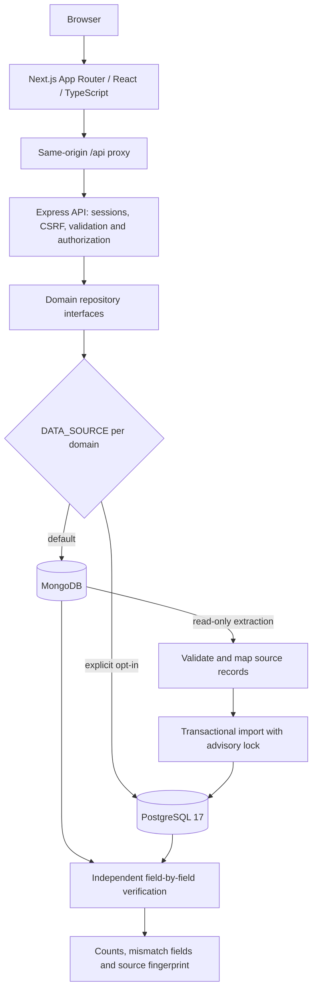
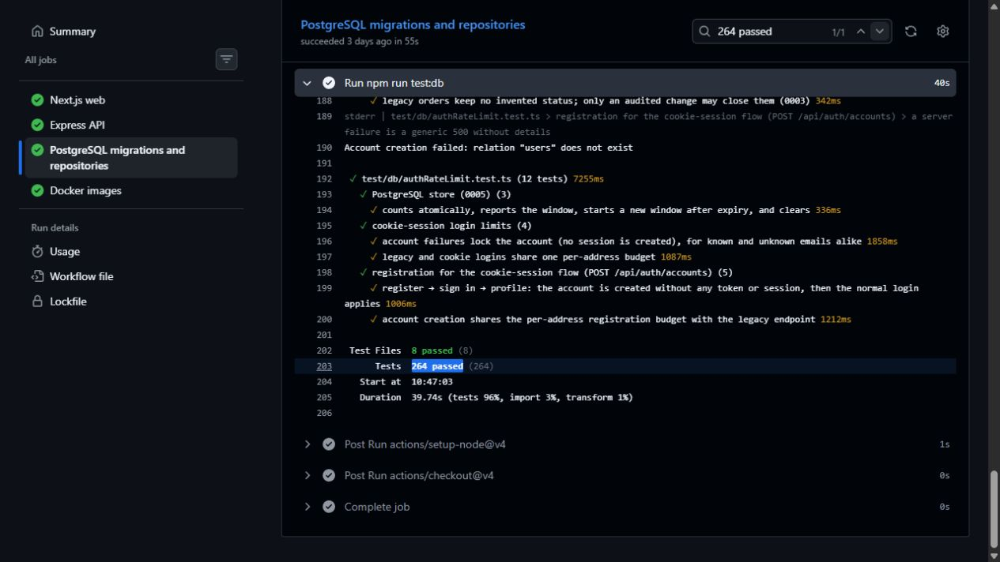

# E-commerce modernization: architecture and evidence

## What was implemented

Developed a staged modernization of an Express commerce API from MongoDB-specific access to domain-selected repository interfaces with PostgreSQL implementations. Added versioned schema migrations, transactional data-copy and independent verification tooling, while retaining MongoDB and the legacy client as rollback paths.

The review branch also contains a Next.js App Router storefront with strict TypeScript, TanStack Query for server state and Redux Toolkit for client-controlled UI state.

**Publication boundary:** this implementation is on `portfolio-week/ecommerce-modernization`. The public default branch remains the older application. Do not describe the review branch as a completed production cutover.

## Engineering problem and approach

Moving every domain at once would make failures difficult to isolate and recovery expensive. The application selects repositories per domain, so products, delivery options, users, carts and orders can be verified independently. The importer copies validated source data in one PostgreSQL transaction, then compares fields against MongoDB using a separate verification mapping.

Schema migrations use history, checksums and an advisory lock. Order handling has transactional rollback, row locking, inventory controls and idempotency rules covered by the PostgreSQL suite. These mechanisms are implementation evidence; they do not measure customer traffic or deployment downtime.

## Request and data-migration architecture



PostgreSQL is not a hidden automatic replacement. No import runs at API startup. MongoDB stays available until an explicitly selected domain is migrated and verified.

## Actual Docker workflow

The committed `ecommerce-backend/compose.yaml` orchestrates PostgreSQL. It does not currently start the entire web/API/database application with one command, and it does not contain a Redis service.

```yaml
name: ecommerce-postgres
services:
  postgres:
    image: postgres:17-alpine
    restart: unless-stopped
    env_file:
      - .env.postgres
    ports:
      - "127.0.0.1:5432:5432"
    volumes:
      - postgres_data:/var/lib/postgresql/data
    healthcheck:
      test: ["CMD-SHELL", "pg_isready -U $$POSTGRES_USER -d $$POSTGRES_DB"]
      interval: 5s
      timeout: 5s
      retries: 10
      start_period: 10s
    stop_grace_period: 1m
volumes:
  postgres_data:
```

Requirements: Node.js 22.12+, npm, and a running Docker engine. API startup also needs the application's MongoDB and private authentication configuration. Use the tracked example configuration and keep credentials in ignored local environment files.

```powershell
cd ecommerce-backend
npm.cmd ci
npm.cmd run postgres:env
docker compose up -d --wait
npm.cmd run postgres:check
```

This starts and checks the development PostgreSQL service without switching an API domain. Use the root README to start the API and Next.js web app separately. The Dockerfiles can build those services, but the current Compose file is database-only.

## Testing & Reliability

The following evidence was checked against commit `bb2944f680fe378baf6d84e7d0703036c9ce5fdf`, on the existing review branch:

| Suite | Actual result | CI evidence |
| --- | --- | --- |
| PostgreSQL migrations/repositories | 264 passed across 8 files | [Job 120373761873](https://github.com/Manoj132508/Ecommerce-project/actions/runs/39941498302/job/120373761873) |
| Express API | 212 passed, 9 todo across 10 files | [Job 120373761690](https://github.com/Manoj132508/Ecommerce-project/actions/runs/39941498302/job/120373761690) |
| Next.js web | 186 passed across 10 files | [Job 120373761374](https://github.com/Manoj132508/Ecommerce-project/actions/runs/39941498302/job/120373761374) |

The [green CI run](https://github.com/Manoj132508/Ecommerce-project/actions/runs/39941498302) ran on 23 October 2026. These are pass counts, not a percentage of lines covered. The nine API todo cases remain explicitly unimplemented; they are not counted as passes.

[Read the actual PostgreSQL job output](evidence/ci-postgres.txt).



To reproduce the PostgreSQL suite from this checkout:

```powershell
cd ecommerce-backend
npm.cmd ci
npm.cmd run test:db
```

The test setup starts a throwaway `postgres:17-alpine` container with generated test credentials and a random loopback port. Each test uses isolated data; the setup removes its own container afterwards. It does not use the development Compose volume or read its credentials.

First-run timing depends on dependency downloads, Docker image availability and the host. There is no verified guarantee that cloning, building and running the complete application plus tests finishes within three minutes.

## Migration status and limits

- The verified work is staged, reversible modernization on a review branch.
- The importer reads MongoDB and writes PostgreSQL; source fingerprint and field comparisons detect drift.
- Production source consistency currently requires freezing writes or using a maintenance window during import, as documented in [the database guide](../ecommerce-backend/db/README.md#safety).
- A measured zero-downtime deployment, concurrent live-write cutover or completed production switch is not established by the repository or its passing tests.
- The historical claim of 120 database tests should be replaced with the revision-specific result of 264 passes in the PostgreSQL suite.

### Evidence-backed portfolio wording

> Developed a staged Express modernization from MongoDB to PostgreSQL using domain-selected repositories, versioned migrations, transactional import and verification tooling. Validated the PostgreSQL migration and repository path with 264 passing integration tests while preserving MongoDB rollback paths.
